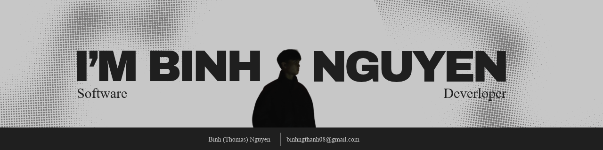

  

<h1 align="left">Hi, I'm Binh Nguyen 👋</h1>

**Backend Developer · SE Student at UIT – VNUHCM**

## 👨‍💻 About Me

- 🎓 Software Engineering student at UIT – VNUHCM.
- 💡 I enjoy solving problems and building software that makes a difference.
- 🔍 Always curious about how systems work behind the scenes.
- 🌱 Learning, experimenting, and improving one project at a time.

 

## 🌐Socials
 

## 🛠️ Tech Stack

### 🚀 Frameworks & Libraries

<table>
  <tr>
    <th align="left">Frontend & UI</th>
    <th align="left">Backend & Database</th>
  </tr>
  <tr>
    <td>
      
      
    </td>
    <td>
      
      
      
      
    </td>
  </tr>
  <tr>
    <td>
      
      
    </td>
    <td>
      
      
      
      
    </td>
  </tr>
</table>

### 🧰 Languages & Tools

**Languages:**

**Tools & Platforms:**

**Design:**

 

## 📊GitHub Stats :
 
 

---

